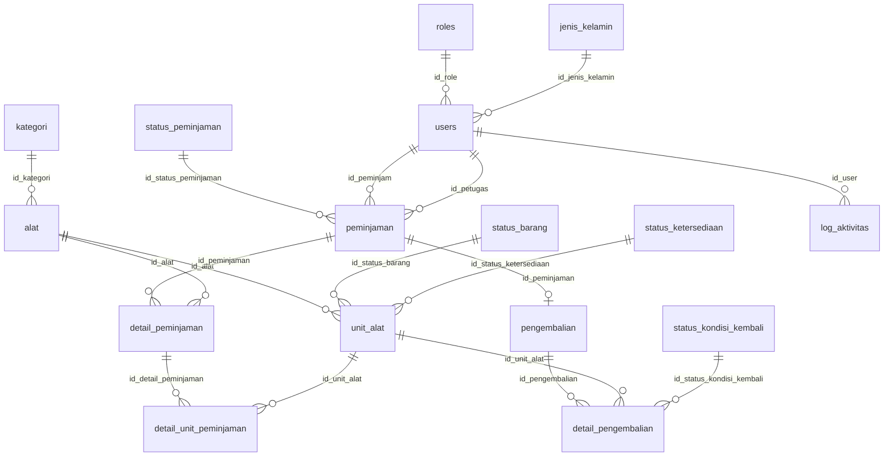
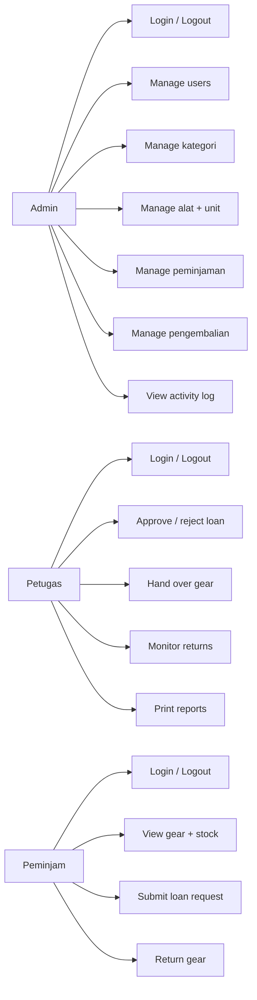
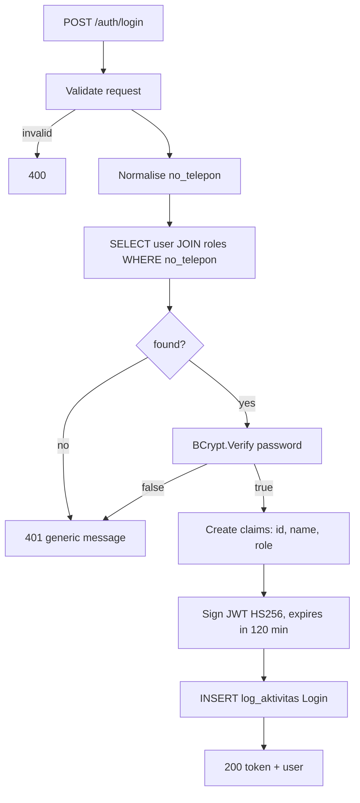
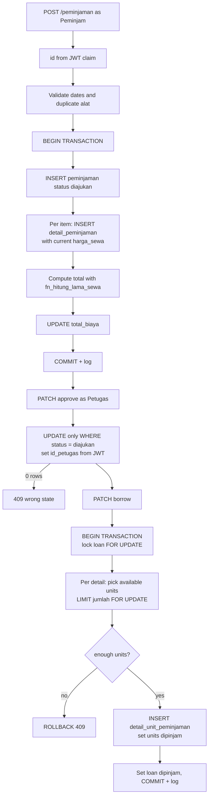
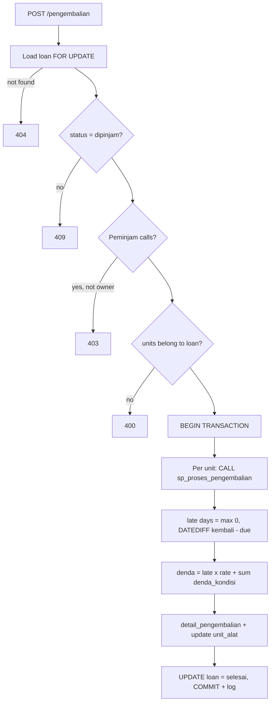

# CampGear — Analysis and Design

## 1. Requirements

### Actors

| Actor | Description |
|---|---|
| Admin | Manages master data, users, loans and returns; reads the activity log |
| Petugas | Approves/rejects requests, hands over gear, monitors returns, prints reports |
| Peminjam | Browses gear, submits loan requests, returns gear |

### Functional requirements

| ID | Requirement | Actor |
|---|---|---|
| F-01 | Login with phone number + password, receive a JWT | All |
| F-02 | Logout (activity log entry, client discards token) | All |
| F-03 | CRUD users, passwords hashed with BCrypt, phone number normalised | Admin |
| F-04 | CRUD kategori | Admin |
| F-05 | CRUD alat and their physical units (`unit_alat`) | Admin |
| F-06 | View the equipment list with category, price and available stock | Peminjam |
| F-07 | Submit a loan request (multiple alat, quantity, dates), total cost computed | Peminjam |
| F-08 | View own loans only | Peminjam |
| F-09 | Approve/reject a request (`diajukan` → `disetujui`/`ditolak`), officer taken from JWT | Petugas |
| F-10 | Hand over the gear (`disetujui` → `dipinjam`), assign physical units | Petugas |
| F-11 | Monitor returns (borrowed, due today, overdue) | Petugas |
| F-12 | Return gear with condition per unit and automatic fines | Peminjam, Petugas |
| F-13 | Print loan and return reports by date range (JSON or CSV) | Petugas |
| F-14 | View the activity log | Admin |
| F-15 | Admin can view and manage all loans and returns | Admin |

### Non-functional requirements

| ID | Requirement |
|---|---|
| N-01 | Dapper parameterised queries only, no string concatenation |
| N-02 | async/await for all database access, no `.Result` / `.Wait()` |
| N-03 | Passwords never returned in a response and never logged |
| N-04 | Role-based access: 401 for missing/invalid token, 403 for wrong role |
| N-05 | Pagination on every list endpoint, maximum page size 100 |
| N-06 | Composed queries (JOIN / subquery / aggregation), no query inside a loop |
| N-07 | Consistent error body for every failure |
| N-08 | Swagger UI with a JWT Authorize button |
| N-09 | Multi-table actions are atomic (one transaction) |
| N-10 | Fine rates configurable in `appsettings.json` |

## 2. ERD

Key notes:

- `users` has two relationships to `peminjaman` (`id_peminjam`, `id_petugas`).
- `pengembalian` has `id_peminjaman UNIQUE` → one return header per loan.
- `detail_unit_peminjaman` records which physical unit was handed over for each loan line.
- Available stock is derived, never stored.

## 3. Use cases

UC-01 Login · UC-02 Logout · UC-03 Manage user · UC-04 Manage kategori ·
UC-05 Manage alat/unit · UC-06 View gear · UC-07 Submit loan · UC-08 Approve/reject ·
UC-09 Handover · UC-10 Monitor returns · UC-11 Return with fine · UC-12 Reports ·
UC-13 Activity log.

## 4. Flowcharts

### 4.1 Login (BCrypt + JWT)

No user enumeration: wrong phone and wrong password return the same body.

### 4.2 Loan: submit → approve → handover

Stock is checked at submission (fast feedback) and locked at handover
(`FOR UPDATE`), which is the authoritative gate.

### 4.3 Return and fine calculation

Fine table:

| Rule | Config key | Column |
|---|---|---|
| Late per day | `Denda:TerlambatPerHari` = 10000 | `pengembalian.denda` |
| baik | 0 | `detail_pengembalian.denda_kondisi` |
| rusak_ringan | 25000 | same |
| rusak_berat | 100000 | same |
| hilang | 250000 | same |

## 5. Database objects added to `query.sql`

| Object | Type | Purpose |
|---|---|---|
| `fn_hitung_lama_sewa` | function | rental days, minimum 1 |
| `fn_hitung_denda_terlambat` | function | `max(0, days late) × daily rate` |
| `sp_ajukan_peminjaman` | procedure | validate one item and insert header + detail atomically |
| `sp_proses_pengembalian` | procedure | per-unit return: fines, unit status |
| `trg_peminjaman_status_log` | trigger | write `log_aktivitas` on status change |
| `uq_users_no_telepon` | constraint | unique phone number (login key) |
| `idx_peminjaman_tanggal`, `idx_log_aktivitas_waktu` | index | date-range reports and log filter |

Schema changes are additive only. Table and column names follow `query.sql`.

## 6. Design decisions

| Decision | Reason |
|---|---|
| Endpoint groups per module | same style as `StatusBarangController`; auth via `.RequireAuthorization(p => p.RequireRole(...))` |
| Dapper + explicit SQL | exam requirement, easy to explain |
| `DefaultTypeMap.MatchNamesWithUnderscores = true` | maps `harga_sewa` → `HargaSewa` without aliases |
| `IDbTransaction` in services | one place per flow (submit, handover, return, delete) |
| CSV for reports | printable, opens in Excel, no PDF library dependency |
| Fine rates in `appsettings.json` | change without touching code or DB |
